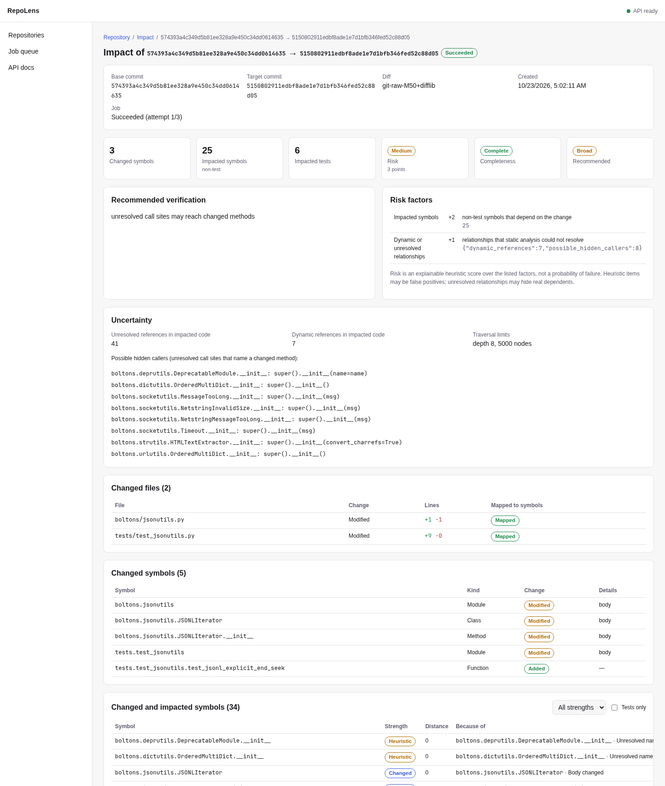
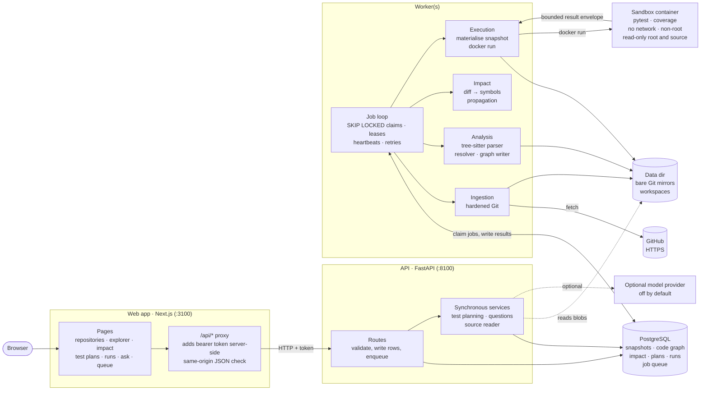
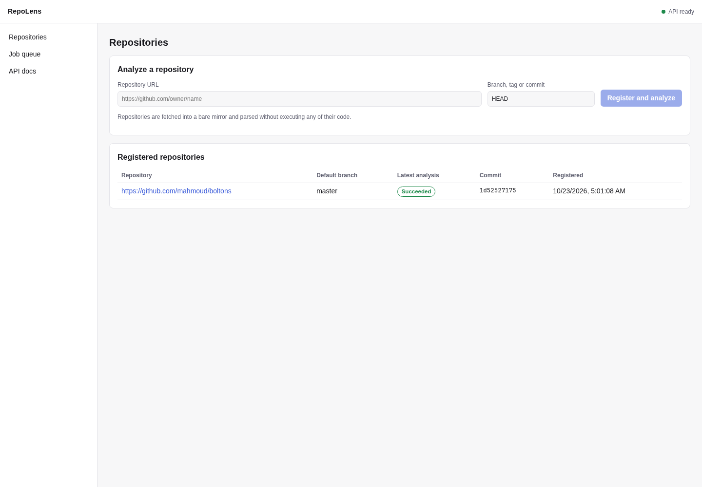
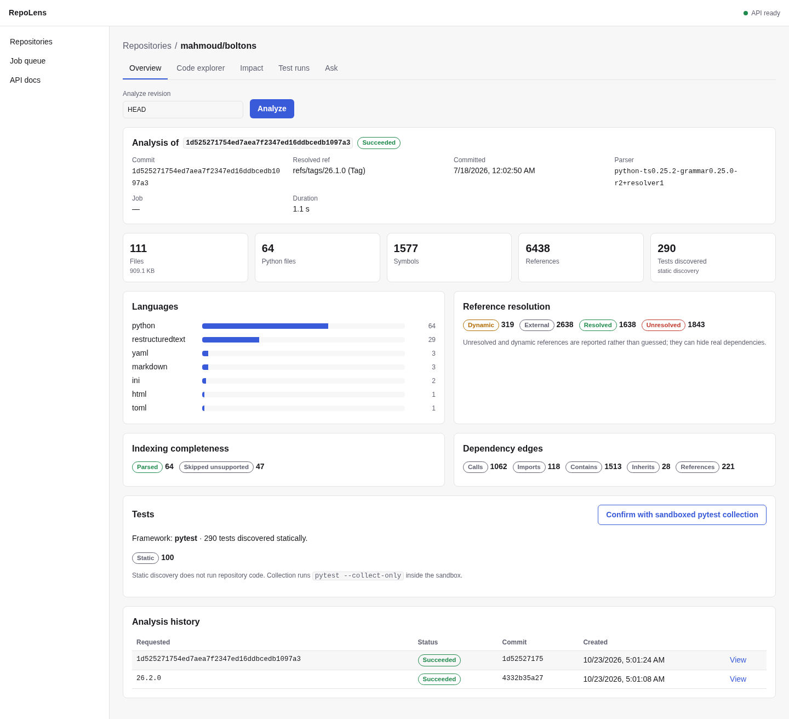
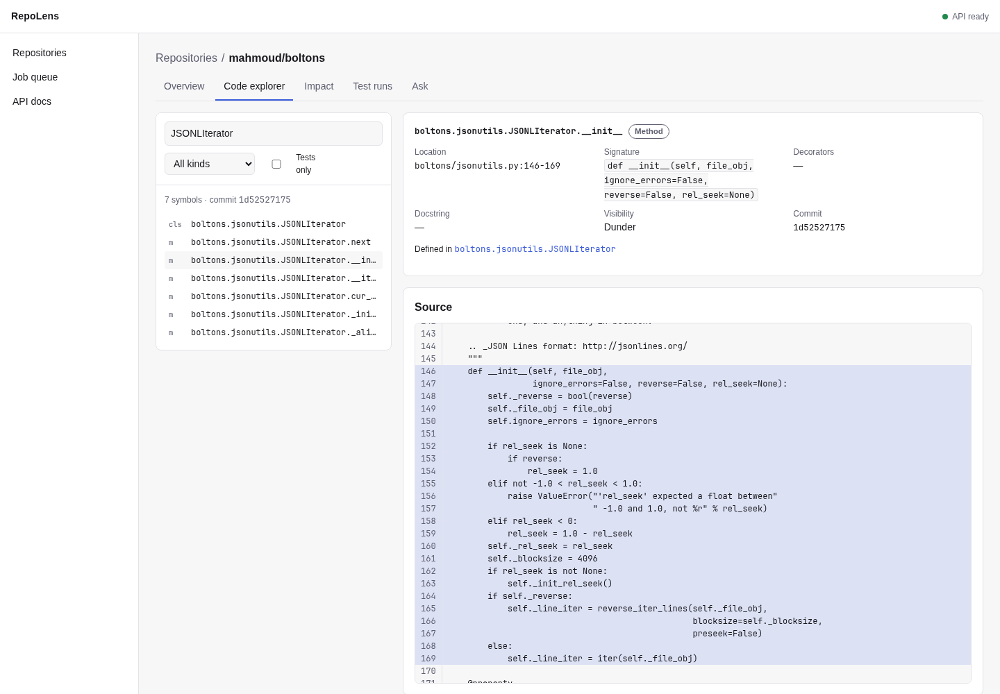
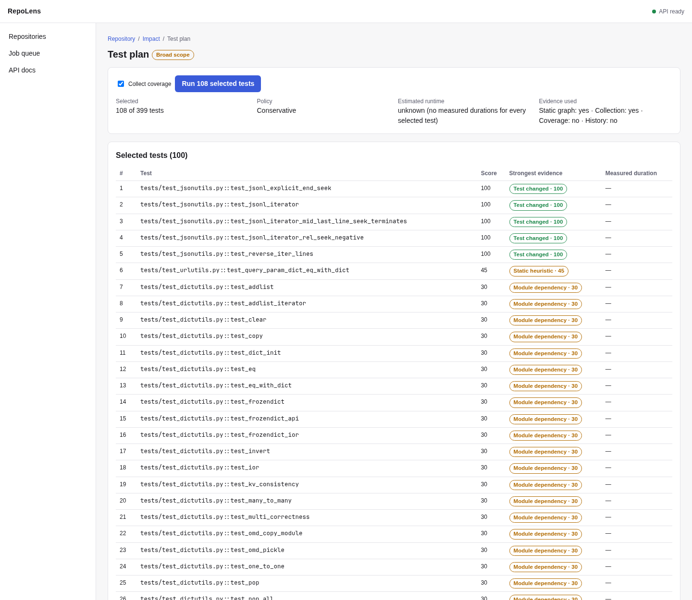
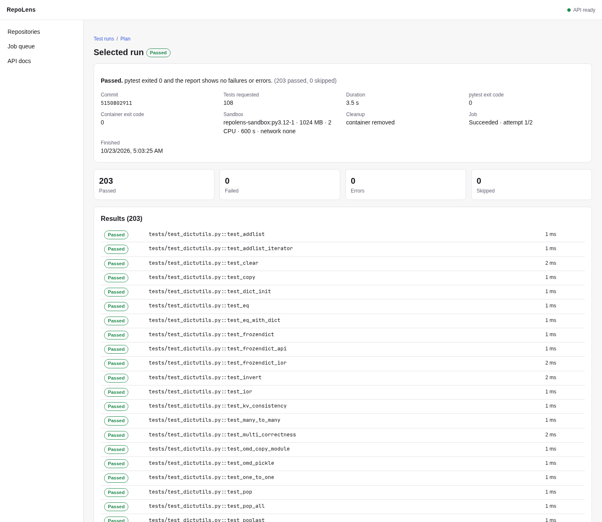
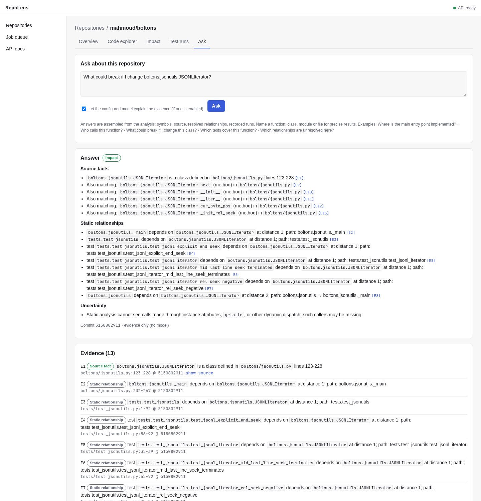
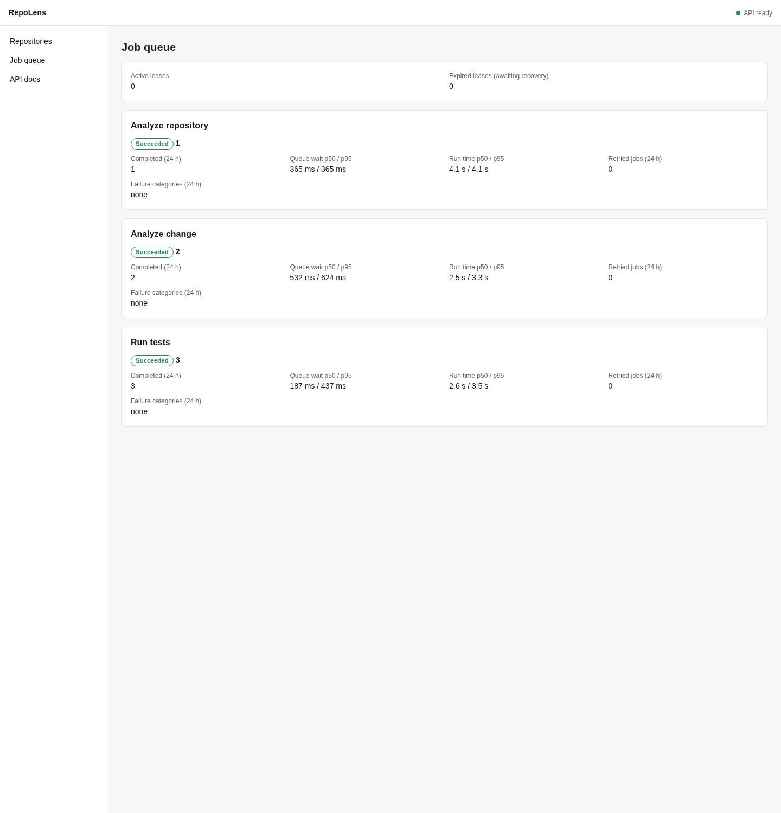

# RepoLens

RepoLens builds a structured model of a repository (symbols, imports, calls,
inheritance and tests) and uses it to explain what a code change affects, choose the tests
that exercise the affected code, and run them in a locked-down container. Every conclusion
carries the evidence it was drawn from. What RepoLens cannot determine is reported as unknown,
not guessed.

Scope: public GitHub repositories (HTTPS). Every text file is inventoried with its language
(by extension) and counted by files, bytes and lines. Symbols, references and complexity are
extracted for Python, JavaScript, TypeScript (including TSX), Go, Java and Rust. Test selection
and sandboxed runs need a Python repository tested with pytest; for other languages they
return 422 with code `language_not_supported`.



<sub>Impact report for a one-line change in
[mahmoud/boltons](https://github.com/mahmoud/boltons) (`5150802`, "jsonutils: accept explicit
end-of-file relative seek"), from a local instance.</sub>

On a large codebase you either run the whole test suite for every change, which is slow, or
guess which tests matter, which is risky. RepoLens selects tests from the dependency graph and
shows its reasoning: every impacted symbol keeps its path back to the change, and every test
records why it was selected or left out. Unresolved and dynamic calls are counted, lower the
report's completeness and widen the recommended scope rather than being dropped. Analysis,
impact, selection and execution are deterministic and never depend on a language model.

## How it works

1. Ingest. A worker fetches a bare Git mirror with a hardened configuration: HTTPS only, no
   hooks, no system or global config, object checks on. It resolves a branch, tag or commit
   to a full SHA and records an immutable snapshot: the file inventory, content hashes,
   languages and any unsafe paths.
2. Parse. Tree-sitter extracts modules, classes, functions, methods, nested definitions,
   decorators, imports, calls, base classes and callback references, with exact source
   spans. A syntax error affects only the region it is in. Parse results for unchanged files
   are cached across analyses.
3. Resolve and build the graph. Every reference gets an explicit status (`RESOLVED`,
   `AMBIGUOUS`, `EXTERNAL`, `UNRESOLVED` or `DYNAMIC`) and the rule that produced it. The
   typed dependency graph (`CONTAINS`, `IMPORTS`, `CALLS`, `INHERITS`, `REFERENCES`) is
   bulk-loaded into PostgreSQL. Each edge records its provenance and an `EXACT` or
   `HEURISTIC` confidence.
4. Impact. For two refs, RepoLens diffs the trees, maps changed hunks to symbols and
   propagates impact backwards through the graph. The report has a risk level with its
   factors, a completeness verdict with the reason for every gap (unparsed files, unresolved
   names, non-Python changes) and a recommended test scope. Documentation and CI or editor
   configuration are treated as having no runtime effect.
5. Test selection. pytest tests are discovered statically, and can be confirmed with a
   sandboxed `pytest --collect-only`. Each selected test records its evidence: test changed,
   direct or transitive static dependency, import, heuristic link, module dependency,
   coverage from an earlier run, or previous failure. The default policy is conservative:
   when a change cannot be traced (packaging config, `conftest.py`, data files with no linked
   test) the plan falls back to the full suite and records why. A budgeted policy lists every
   test it leaves out and why.
6. Sandboxed run. Selected or full runs execute in a pinned Docker image with no network, a
   non-root user, no capabilities, a read-only root and source mount, and memory, CPU,
   process and time limits. Results come back only through a bounded, validated channel.
   Each run ends as `PASSED`, `FAILED`, `TIMED_OUT`, `CANCELLED`, `COLLECTION_ERROR`,
   `RESOURCE_LIMIT_EXCEEDED`, `SECURITY_POLICY_BLOCKED` or `INFRASTRUCTURE_ERROR`.
7. Questions. Questions such as "Who calls X?" or "What could break if I change Y?" are
   answered from evidence retrieved deterministically from the graph, analysis warnings and
   test runs, with citations. Without a language model, RepoLens returns the evidence and a
   structured summary; with one, the model phrases the answer (see
   [Language model policy](#language-model-policy)).

All of this runs as jobs on a PostgreSQL-backed queue with leases, heartbeats, retries with
backoff, cancellation, recovery of abandoned jobs, and per-repository and sandbox concurrency
limits.

## Architecture



The web app renders what the API returns and holds no business logic. Its server-side
`/api/*` route forwards requests to the API and attaches the API token, so the token never
reaches the browser, and it forwards a mutation only if it is a same-origin JSON request.
With Supabase sign-in turned on it forwards the signed-in user's access token instead, and
each user sees only their own repositories ([deployment](docs/deployment.md#sign-in-with-supabase)).

The API validates requests, writes rows and enqueues jobs. Test planning and questions touch
only the database (and the local mirrors, for source snippets), so they run synchronously in
the API. The API never fetches repositories from the network (with sign-in on, it loads only
Supabase's public signing keys) and never runs Docker.

PostgreSQL holds all results and the job queue. Workers claim jobs with
`SELECT … FOR UPDATE SKIP LOCKED`, hold leases with heartbeats, and write results only while
they still hold the lease. Workers do everything slow or untrusted: fetching, parsing,
resolving, impact propagation and test runs. Repository code runs only in the sandbox
container.

[docs/architecture.md](docs/architecture.md) covers the data model and pipelines, and
[docs/security/sandbox.md](docs/security/sandbox.md) the sandbox threat model.

## Screenshots

All screenshots come from a local instance analysing
[mahmoud/boltons](https://github.com/mahmoud/boltons). The change shown is commit `5150802`,
a one-line fix to `JSONLIterator.__init__` with a new test.

Repositories: register a GitHub repository and pick a branch, tag or commit to analyse.



Analysis overview: file, symbol and reference counts, how references were resolved,
dependency edges by type, and statically discovered tests.



Code explorer: search symbols and view their signature, location and source, with callers,
callees and unresolved references.



Impact report: changed symbols, impacted symbols with the strength of each link, risk
factors, completeness, and the uncertainty behind the recommended scope. Here,
`super().__init__()` calls elsewhere in boltons could reach a changed `__init__`, so the
scope is *Broad* (see [Known analysis limits](#known-analysis-limits)).


Test plan: 108 of 399 tests selected, each with its strongest evidence, changed tests first,
then heuristic and module-dependency links. Sandboxed collection was used to drop a
statically discovered name that pytest does not collect.



Sandboxed run: the selected tests in the sandbox image (1024 MB, 2 CPUs, 600 s,
`network none`). 203 passed, counting parametrised cases, and the container was removed
afterwards.



Questions: "What could break if I change boltons.jsonutils.JSONLIterator?", answered from
static relationships with numbered citations and no model (`evidence only`).



Job queue: per-kind counts, p50/p95 queue wait and run time, retries and lease state.



## Tech stack

| Area | Technology |
|---|---|
| API | Python 3.12+ (developed on 3.14), FastAPI, Uvicorn, Pydantic v2 and pydantic-settings |
| Persistence | PostgreSQL 16, SQLAlchemy 2, Alembic, psycopg 3 (graph bulk-loaded with `COPY`) |
| Code intelligence | tree-sitter 0.25, tree-sitter-python and tree-sitter-language-pack 0.13 (JavaScript, TypeScript, Go, Java, Rust) |
| Jobs | A PostgreSQL-backed queue with leases, heartbeats, retries and advisory-lock limits |
| Sandbox | Docker CLI with a pinned `python:3.12-slim` image (digest-pinned, hash-locked pytest and coverage) |
| Web | Next.js 16 (App Router), React 19, TypeScript |
| Optional model | Anthropic SDK (`uv sync --extra llm`), off by default |
| Tooling | uv, Ruff, mypy (strict), import-linter, pytest, Vitest, ESLint, Playwright |

## Project structure

```
RepoLens/
├── src/repolens/
│   ├── api/              # FastAPI app, routes, schemas, error handling
│   ├── worker/           # job loop, handlers, entry point
│   ├── services/         # analysis, change analysis, impact, planning, execution, questions
│   ├── persistence/      # SQLAlchemy models, job queue, graph queries, bulk writer
│   ├── domain/           # enums, spans, job state machine (no IO)
│   ├── repository/       # URL validation, hardened Git, mirrors, inventory, materialiser
│   ├── parsers/          # tree-sitter adapter
│   ├── codegraph/        # module naming, name resolution, traversal
│   ├── impact/           # diff mapping and propagation
│   ├── test_selection/   # evidence and selection policies
│   ├── execution/        # sandbox policy, Docker runner, outcomes
│   ├── llm/              # optional model provider
│   └── config.py         # all REPOLENS_* settings
├── apps/web/             # Next.js UI: src/app (pages + /api proxy), components, lib, e2e
├── migrations/           # Alembic migrations
├── infra/
│   ├── docker/sandbox/   # sandbox image: Dockerfile, hash-locked requirements, runner
│   ├── docker/app/       # production API and worker image
│   ├── docker/web/       # production web image
│   ├── docker/postgres/  # init script (test database)
│   └── caddy/            # optional TLS reverse proxy config
├── tests/                # unit, integration, security, support
├── scripts/              # check.sh, e2e.sh, build-sandbox.sh, benchmark.py, fixture builder
├── docs/                 # architecture, API, operations, deployment, demo, security, benchmarks
├── docker-compose.yml        # local PostgreSQL
└── docker-compose.prod.yml   # single-host production stack
```

The Python package is layered, and import-linter enforces the layering in CI:
`api`/`worker` → `services` → `persistence` → `domain`. The analysis libraries
(`repository`, `parsers`, `codegraph`, `impact`, `test_selection`, `execution`) have no
database or web code.

## Getting started

Requirements: Linux, Python 3.12+ with [uv](https://docs.astral.sh/uv/), Docker with Compose
(cgroup v2), and Node.js 22+ with npm.

```bash
git clone https://github.com/Sanskriti10247/RepoLens.git && cd RepoLens

cp .env.example .env                 # then set REPOLENS_API_TOKEN (.env is gitignored)
python3 -c "import secrets; print(secrets.token_urlsafe(32))"   # a value for the token

docker compose up -d postgres        # PostgreSQL on 127.0.0.1:5433
uv sync                              # Python dependencies
uv run alembic upgrade head          # apply migrations
./scripts/build-sandbox.sh           # build the pinned sandbox image (repolens-sandbox:py3.12-1)
npm ci                               # web dependencies
```

Then run each process in its own terminal:

```bash
uv run repolens-api                  # API on http://127.0.0.1:8100 (OpenAPI docs at /api/docs)
uv run repolens-worker               # background worker (ingestion, analysis, impact, test runs)
REPOLENS_API_TOKEN=... npm run web:dev   # UI on http://127.0.0.1:3100
```

Configuration is read from `REPOLENS_*` environment variables or `.env`.
`src/repolens/config.py` lists the limits on repository size, file counts, timeouts, sandbox
resources, concurrency and the parse cache. [docs/demo.md](docs/demo.md) is an offline
walkthrough with a fixture repository.

## Using RepoLens

### In the browser

1. On **Repositories**, enter a GitHub URL and a revision, then choose **Register and
   analyze**.
2. Use **Code explorer** to search symbols, read their source, and follow callers and
   callees.
3. On **Impact**, enter a base and a target revision, then choose **Analyze impact**.
4. From the report, choose **Select tests**. Optionally, on the overview, first choose
   **Confirm with sandboxed pytest collection** so the plan uses what pytest actually
   collects.
5. Choose **Run N selected tests** and follow the run page until it reaches an outcome.
6. Use **Ask** for questions such as *Who calls X?* or *What could break if I change Y?*
7. Use **Job queue** to see every job, with attempts, timings and errors.

### Through the API

Reads are open; mutations need `Authorization: Bearer $REPOLENS_API_TOKEN`. The full
reference is served at `/api/docs`, and [docs/api.md](docs/api.md) covers the conventions.
The responses below are from a local instance, trimmed at `…`.

Register a repository:

```bash
H="Authorization: Bearer $REPOLENS_API_TOKEN"; API=http://127.0.0.1:8100/api
curl -s -H "$H" -H 'content-type: application/json' \
  -d '{"url":"https://github.com/mahmoud/boltons"}' $API/repositories
```

```json
{
  "id": "7d457980-4c21-4cc9-9934-5b3a63c77beb",
  "provider": "github",
  "host": "github.com",
  "owner": "mahmoud",
  "name": "boltons",
  "canonical_url": "https://github.com/mahmoud/boltons",
  "default_branch": null,
  "created_at": "2026-10-22T23:31:08.883922Z",
  "latest_analysis": null
}
```

Queue an analysis of a tag. It returns `202` with status `QUEUED`; poll
`GET /analyses/{id}` until it finishes:

```bash
curl -s -H "$H" -H 'content-type: application/json' -d '{"ref":"26.2.0"}' \
  $API/repositories/7d457980-4c21-4cc9-9934-5b3a63c77beb/analyses
curl -s $API/analyses/3cb2a6dd-9ada-41d5-81f2-9cd83595faeb
```

```json
{
  "id": "3cb2a6dd-9ada-41d5-81f2-9cd83595faeb",
  "status": "SUCCEEDED",
  "requested_ref": "26.2.0",
  "resolved_ref": "refs/tags/26.2.0",
  "resolved_ref_kind": "TAG",
  "counts": {
    "files": 112,
    "python_files": 65,
    "code_files": 65,
    "code_files_by_language": {"python": 65},
    "symbols": 1681,
    "references": 7071,
    "references_by_status": {"DYNAMIC": 364, "EXTERNAL": 2875, "RESOLVED": 1839, "UNRESOLVED": 1993},
    "edges_by_type": {"CALLS": 1173, "IMPORTS": 132, "CONTAINS": 1616, "INHERITS": 28, "REFERENCES": 241},
    "tests_discovered": 366,
    …
  },
  "timings_ms": {"fetch_ms": 2905.7, "analyze_ms": 1069.6, "snapshot_ms": 42.0},
  …
}
```

The impact report for the one-line `JSONLIterator` change (base `574393a`, target
`5150802`):

```bash
curl -s $API/impact/5a1c0fe7-e35e-441c-85e8-8dc9c9d5bf23/report
```

```json
{
  "completeness": "COMPLETE",
  "completeness_reasons": [],
  "risk_level": "MEDIUM",
  "risk_factors": [
    {"factor": "impacted_symbols", "value": 25, "points": 2,
     "detail": "non-test symbols that depend on the change"},
    {"factor": "dynamic_or_unresolved_relationships", "points": 1,
     "value": {"dynamic_references": 7, "possible_hidden_callers": 8},
     "detail": "relationships that static analysis could not resolve"}
  ],
  "recommended_scope": "BROAD",
  "scope_reasons": ["unresolved call sites may reach changed methods"],
  "counts": {
    "changed_files": 2, "changed_symbols": 3, "impacted_symbols": 25, "impacted_tests": 6,
    "by_strength": {"CHANGED": 4, "DIRECT": 1, "TRANSITIVE": 1, "HEURISTIC": 28}
  },
  …
}
```

The sandboxed run of the selected tests:

```bash
curl -s $API/test-runs/bf5a6255-d51a-454a-a50d-c0a46c0ccee5
```

```json
{
  "mode": "SELECTED",
  "commit_sha": "5150802911edbf8ade1e7d1bfb346fed52c88d05",
  "status": "COMPLETED",
  "outcome": "PASSED",
  "outcome_reason": "203 passed, 0 skipped",
  "counts": {"total": 203, "passed": 203, "failed": 0, "error": 0, "skipped": 0},
  "duration_ms": 3506.0,
  "image": "repolens-sandbox:py3.12-1",
  "limits": {"cpus": 2.0, "pids": 256, "tmp_mb": 128, "network": "none",
             "memory_mb": 1024, "workspace_mb": 1024, "timeout_seconds": 600.0},
  "cleanup_ok": true,
  …
}
```

The full workflow, including graph queries, test plans and questions, is in
[docs/api.md](docs/api.md#workflow).

## Checks

```bash
./scripts/check.sh                   # format, lint, types, layering, Python tests, web checks
REPOLENS_REQUIRE_DOCKER=1 ./scripts/check.sh   # also fail if sandbox tests cannot run
./scripts/e2e.sh                     # browser workflow against a real API, worker and database
```

Integration tests use the `repolens_test` database and reset its schema on each run. They are
skipped when PostgreSQL is unreachable unless `REPOLENS_REQUIRE_INTEGRATION=1` is set, as in
CI. Sandbox tests need Docker and the sandbox image.

`scripts/benchmark.py` measures analysis, incremental analysis, impact, selection overhead,
sandbox startup and selected-versus-full test runs on real repositories. Results and
methodology are in [docs/benchmarks](docs/benchmarks/).

## Deployment

`docker-compose.prod.yml` runs RepoLens on a single Linux server: PostgreSQL, a one-shot
migration job, the API, a worker, the web app and, optionally, Caddy for TLS and basic auth.
The worker needs the host's Docker socket to launch sandboxes, which makes it
root-equivalent on that host, and rules out serverless platforms and PaaS without Docker
access. [docs/deployment.md](docs/deployment.md) covers setup, that trade-off and its
alternatives, upgrades and backups; [docs/operations.md](docs/operations.md) covers the
operating model.

A small demo instance runs as one container on Render's free tier, with the web app on
Vercel. It analyzes public repositories up to 50 MiB, but does not run tests (no Docker
there), and its data resets to a recorded snapshot whenever the service restarts or wakes
from sleep. See [Free hosting](docs/deployment.md#free-hosting-vercel--render).

## Known analysis limits

Python is dynamic, so static analysis has blind spots:
- RepoLens does not infer the types of variables or return values. Calls on instance
  attributes (`self.client.get()`) or on values returned by other calls are therefore
  reported as unresolved.
- `getattr`, `importlib`, `eval` and subscripted calls are reported as dynamic.
- Calls through `self`, `cls` and `super()` follow an approximate method resolution order and
  are marked heuristic.
- Static test discovery works by name. A pytest fixture named like a test (in boltons,
  `@pytest.fixture def test_url(...)`) is listed as a test until a sandboxed
  `pytest --collect-only` marks it as not collected. Without that step, pytest rejects the
  unknown node id and a boltons run ends in `COLLECTION_ERROR`.

Other languages resolve less. Names defined or imported in the same file, members reached
through `this`/`self`/`super` inside a class, relative JavaScript/TypeScript imports
(`./util`, `./util.js` for `util.ts`, `./dir/index`) and Java imports that match a file path
are resolved. Package imports, Go names defined in other files of the same package, Rust
`use` paths and everything else are reported as unresolved. Branches inside anonymous
functions (callbacks, closures) are not counted toward any function's complexity.

These gaps lower the completeness of an impact report and push test selection towards a
broader scope. Coverage from an earlier sandboxed run, when available, adds evidence that
static analysis misses.

## Language model policy

The model provider is off by default (`REPOLENS_LLM_PROVIDER=none`). When it is enabled
(`REPOLENS_LLM_PROVIDER=anthropic`, `uv sync --extra llm`, `ANTHROPIC_API_KEY` set):
- Source code is withheld unless `REPOLENS_LLM_ALLOW_SOURCE_UPLOAD=true`. With source
  withheld, only symbol names, paths, graph facts, warnings and test outcomes are sent;
  docstrings and source snippets count as source.
- Answers must cite the retrieved evidence. An answer with unknown citations, a refusal or an
  error falls back to the deterministic answer.
- RepoLens checks that every cited evidence id exists. It cannot check that the explanation
  is true, and repository text can try to steer the model, so the cited evidence is always
  shown next to the explanation.

The provider integration is tested against a fake client only, not the live API.
